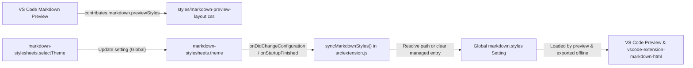

# Technical Documentation — Markdown Stylesheets

This engineering reference covers the dual stylesheet injection model, non-destructive global `"markdown.styles"` reconciliation, contributed command/setting surface, and packaging rules across [`src/extension.js`](../src/extension.js), [`package.json`](../package.json), and `styles/*.css`.

## 1. Architecture & Repository Layout

```text
vscode-extension-markdown-stylesheets/
├── .gitignore                        # Ignores *.htmd, node_modules/, *.vsix, .DS_Store
├── .vscodeignore                     # Excludes package-lock.json, .gitignore, *.vsix, docs/, .agents/, *.htmd
├── license.md                        # MIT license
├── package.json                      # Manifest declaring previewStyles, selectTheme command & theme setting
├── readme.md                         # User-facing overview, theme table & usage
├── docs/
│   └── technical.md                  # Stylesheet reconciliation internals & CSS asset reference
├── src/
│   └── extension.js                  # syncMarkdownStyles reconciler & QuickPick command handler
└── styles/
    ├── markdown-preview-layout.css   # Always-active 902px centered container & overflow rules
    ├── markdown-vscode-light2026.css # VS Code Light 2026 stylesheet
    ├── markdown-vscode-dark2026.css  # VS Code Dark 2026 stylesheet
    ├── markdown-github-light.css     # GitHub Light Default stylesheet
    └── markdown-github-dark.css      # GitHub Dark Default stylesheet
```



## 2. Dual Stylesheet Injection & Settings Reconciliation

[`package.json`](../package.json) separates structural layout from explicit color themes across two VS Code channels. [`styles/markdown-preview-layout.css`](../styles/markdown-preview-layout.css) loads automatically through `"contributes.markdown.previewStyles"`, constraining the preview body to a centered `902px` reading column (`32px` padding, reset cleanly inside `@media print`), allowing wide tables to scroll horizontally (`max-width: 100%; overflow: auto`), and adding GitHub-style `Copy code to clipboard` / `Copied!` tooltips on `.code-block-copy-button`. Because it loads via `previewStyles`, the centered layout stays active in `"auto"` mode without touching `settings.json`.

When a named preset is active, [`syncMarkdownStyles`](../src/extension.js#L11-L47) maps `"markdown-stylesheets.theme"` through `THEME_FILES` and updates the user's global `"markdown.styles"` configuration on startup (`onStartupFinished`) and configuration change events. Naively appending or overwriting `"markdown.styles"` would accumulate broken versioned extension paths after updates or wipe custom user CSS files. To prevent both issues, `syncMarkdownStyles` normalizes each existing string entry (`path.normalize(s).toLowerCase()`), filters out any path starting with `extensionPath` or whose basename matches any file in `THEME_FILES`, and preserves everything else in `otherStyles`. In `"auto"` mode, it writes `otherStyles.length > 0 ? otherStyles : undefined` only if managed entries were actually present; in named preset modes, it performs an element-by-element equality check before writing `[...otherStyles, targetCssPath]` to `vscode.ConfigurationTarget.Global`.

## 3. Commands, Settings & Theme Asset Reference

| Contribution ID | Type | Default | Description |
| :--- | :--- | :--- | :--- |
| `markdown-stylesheets.selectTheme` | Command | — | Opens a QuickPick marking the active preset (`picked: true`) and writes `markdown-stylesheets.theme` globally. |
| `markdown-stylesheets.theme` | String Enum | `"auto"` | Selects `auto`, `vscode-light2026`, `vscode-dark2026`, `github-light`, or `github-dark`. |

| Theme Key | Bundled Stylesheet | Background | Body Text | Interoperability |
| :--- | :--- | :--- | :--- | :--- |
| `"auto"` | [`styles/markdown-preview-layout.css`](../styles/markdown-preview-layout.css) | *(VS Code)* | *(VS Code)* | Active in all previews via `previewStyles`; clears managed `"markdown.styles"` entries. |
| `"vscode-light2026"` | [`styles/markdown-vscode-light2026.css`](../styles/markdown-vscode-light2026.css) | `#FFFFFF` | `#202020` | Sets GitHub Alert `--color-*` variables for [vscode-extension-markdown-alert](https://github.com/tbruneel/vscode-extension-markdown-alert) and inline export by [vscode-extension-markdown-html](https://github.com/tbruneel/vscode-extension-markdown-html). |
| `"vscode-dark2026"` | [`styles/markdown-vscode-dark2026.css`](../styles/markdown-vscode-dark2026.css) | `#121314` | `#BBBEBF` | Same alert variable overrides and export styling for dark VS Code 2026 surfaces. |
| `"github-light"` | [`styles/markdown-github-light.css`](../styles/markdown-github-light.css) | `#FFFFFF` | `#1F2328` | GitHub Light syntax highlighting and `--color-*` alert variables. |
| `"github-dark"` | [`styles/markdown-github-dark.css`](../styles/markdown-github-dark.css) | `#0D1117` | `#F0F6FC` | GitHub Dark syntax highlighting and `--color-*` alert variables. |

## 4. Packaging

```powershell
# Inspect packaged archive contents and build the local .vsix package
npx @vscode/vsce ls --no-dependencies
npx @vscode/vsce package --no-dependencies
```

Because [`package.json`](../package.json) sets `"main": "./src/extension.js"` with pure CommonJS JavaScript (`vscode` and `path`) and static CSS assets, no compilation or bundling step is required. [`.vscodeignore`](../.vscodeignore) excludes `package-lock.json`, `.gitignore`, `*.vsix`, `**/*.htmd`, `docs/**`, and `.agents/**`, retaining `package.json`, `license.md`, `readme.md`, `src/extension.js`, and `styles/*.css`.
